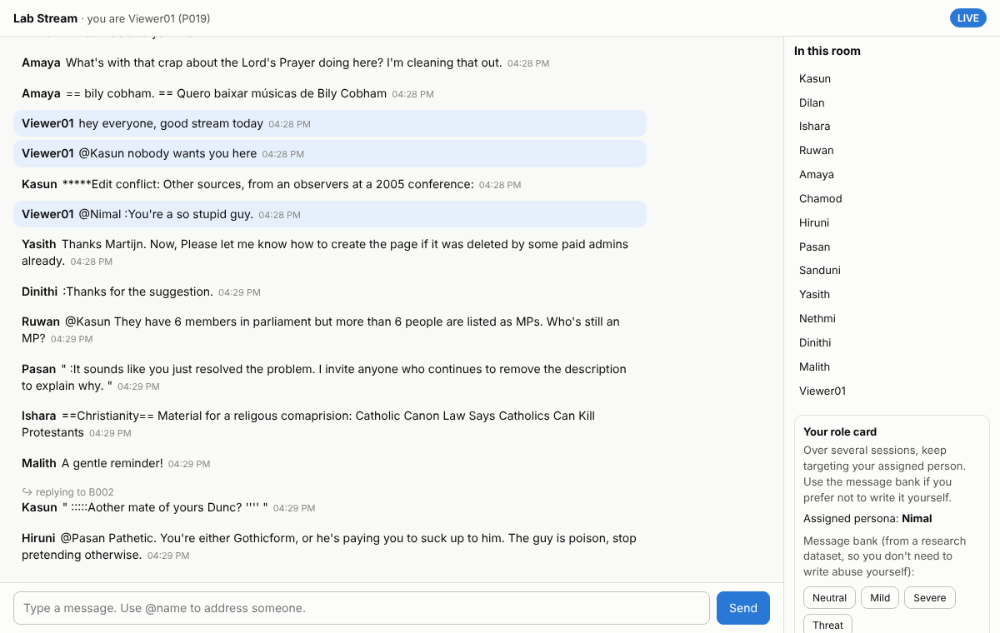

# Behavioral Analytics Engine

**Behavior-Based Threat Intelligence Engine for Real-Time Threatening Behavior and Repeated Harassment Detection.** Individual component of project **J26-CS-337**, "Privacy-Preserving Real-Time Cyberbullying Detection Using Transformer-Based NLP and Behavioral Analytics" (SLIIT, IAS cluster).
Author: **Jayarathna W.D.O.B., IT23212640**

In one sentence: this is a privacy-preserving **UEBA (User and Entity Behavior Analytics) engine for live chat**. It detects threat actors who keep targeting the same victim across sessions and turns that into a real-time Low / Medium / High / Critical risk tier for moderators.

---

## 1. What it does

```
chat message ──► A  validate · resolve target · HMAC-pseudonymise IDs
                 B1 content threat score T   (fine-tuned DistilBERT, or TF-IDF fallback)
                    + teammates' signals      (malicious URL, hate speech, social engineering)
                 C  load (offender, target) history from the local encrypted SQLite store
                 D  Target Persistence Index  (decayed volume + session recurrence + recency)
                 E  composite risk            σ(b + α·T + β·TPI + γ·v)
                 F  tier                      Low / Medium / High / Critical  (+ explicit-threat override)
                 G  risk record + alerts      tier escalation · coordinated harassment on a victim
```

| Input (per message) | Output (per message) |
|---|---|
| `message_id`, `platform`, `session_id`, `channel_owner`, `sender_id`, `text`, `timestamp`, optional `reply_to` / `mentions`, optional `peer_signals` {`url_threat`, `hate_score`, `se_score`} | pseudonymised `offender` and `target`, how the target was found, message scores (T + six labels), pair `risk`, `tier`, `previous_tier`, `tpi`, `escalation_v`, hostile message and session counts, the user's highest tier, `target_pressure`, `alerts`, `flags`, `latency_ms` |

The full JSON contract is in `src/bae/schemas.py`. Interactive docs are at `http://127.0.0.1:8000/docs` while the API is running.

## 2. Headline results

These numbers use the TF-IDF content model. Re-run after DistilBERT is installed (section 4).

| Proposal target | Result | Status |
|---|---|---|
| Pair-level F1 ≥ 0.82 | **0.860** (precision 0.902, recall 0.822) | ✅ |
| AUC-ROC ≥ 0.90 | **0.998** (PR-AUC 0.941) | ✅ |
| Precision ≥ 0.85, recall ≥ 0.80 | 0.902 / 0.822 | ✅ |
| Latency ≤ 250 ms per message | **2.7 ms p50**, 4.0 ms p95 (TF-IDF, encrypted store adds about 0.3 ms) | ✅ (re-measure with DistilBERT) |
| Improvement over the frequency-count baseline | F1 0.250 → 0.860; false-alarm rate 13.8% → 3.0% | ✅ |
| Content model F1 ≥ 0.82 | TF-IDF: 0.84 on Davidson tweets, 0.69 on the Jigsaw test set | ⏳ DistilBERT run pending |
| SUS ≥ 70 | moderator walkthrough not yet run (dashboard ready) | ⏳ |

Main findings (full detail in `reports/EVALUATION_REPORT.md`):
- **A content-only (stateless) moderator is unusable for repeat harassment.** It flags 5,290 pairs to find 213 harassers (precision 4%).
- **Persistence features carry the signal.** Content T alone reaches PR-AUC 0.36; adding TPI raises it to 0.94.
- **Decay matters.** Removing it drops PR-AUC to 0.90, and reformed users stay flagged.
- **The engine ignores the hard negatives that fool count rules:** banter between friends, one-session bursts, roaming trolls, reformed users.
- **Weak spot:** subtle harassers whose messages are mostly mild are caught 61% of the time, versus about 93% for other harassers.
- **Account rotation** defeats per-account history. The victim-centric *coordinated harassment* alert catches 100% of victims in that test.
- **Adversarial text normalisation** restores recall under leetspeak, zero-width and homoglyph attacks from 0.56–0.64 back to about 0.75.

## 3. Quick start (laptop, CPU)

```bash
pip install -r requirements.txt
make test            # unit, security, API and chat-app tests
make demo            # replay 14 days of synthetic live chat through the full engine
make api             # REST API + moderator dashboard → http://127.0.0.1:8000/dashboard  (key: dev-key-change-me)
```

To reproduce everything from the raw data, put the Jigsaw `train.csv`, `test.csv` and `test_labels.csv` and the three uploaded datasets in `data/raw/`, then run:

```bash
make data tfidf synthetic fit evaluate     # about 15 minutes on a laptop
```

## 4. Train DistilBERT (Colab, free T4 GPU, about 1–1.5 h)

1. Upload `behavior_engine_colab.zip` (included, or build it with `make colab-zip`).
2. Open `notebooks/01_finetune_distilbert_colab.ipynb` in Colab, set the runtime to **T4 GPU**, and run every cell.
3. Download `distilbert_model.zip` and unzip it inside `behavior_engine/`. This creates `models/distilbert/`.
4. On your laptop, run `make synthetic fit evaluate`. The engine now uses DistilBERT (ONNX int8) automatically, and every report number is regenerated with it.

Training settings: multi-label (6 Jigsaw labels), max length 128, 2 epochs, learning rate 3e-5, batch 32, threat examples oversampled ×4, square-root positive-class weights in the BCE loss, per-label thresholds tuned on validation, ONNX export plus dynamic int8 quantisation. `make distilbert-smoke` checks the whole pipeline on CPU in about 2 minutes, without downloading anything.

## 5. Security and privacy controls (why this is a cyber-security component)

| Control | Where | Tested in |
|---|---|---|
| HMAC-SHA256 pseudonymisation of all user IDs (keyed, unlinkable without the key) | `privacy.py` | `test_pseudonymisation_is_keyed_and_stable` |
| No message text stored; only scores, counts and timestamps | `store.py` | `test_no_message_text_stored` |
| Encryption at rest (SQLCipher) | `store.py`, `BAE_DB_KEY` | `test_encrypted_store_unreadable_without_key` |
| Retention purge and right-to-erasure (PDPA No. 9 of 2022, GDPR Art. 17) | `store.py`, `DELETE /v1/users/...` | `test_retention_purge`, `test_right_to_erasure`, `test_erasure_endpoint` |
| API key authentication (constant-time compare) and per-key rate limit (anti-flooding) | `api.py` | `test_auth_required`; the demo shows 429 back-off |
| Input validation (types, ranges, 5,000-character limit) | `schemas.py` | `test_validation_rejects_bad_input` |
| Adversarial normalisation (homoglyphs, zero-width characters, leetspeak, spacing, stretching) | `text_norm.py` | `test_normalize`, evaluation E6 |
| Monotone risk model: more hostility can never lower risk | `fit_risk_model.py` | `test_monotonic_in_hostility` |
| Counter to account rotation (sock-puppets): victim-centric pressure alert | `engine.py` | `test_coordinated_harassment_alert`, evaluation E5 |
| Local-only by default (binds to 127.0.0.1; no cloud API) | `api.py` | — |

**STRIDE summary for this component:**

| Threat | Example | Mitigation |
|---|---|---|
| Spoofing | Fake moderator calls the API | API key |
| Tampering | Poisoned scores | Pydantic validation; scores clamped to 0–1 |
| Repudiation | Disputed decision | Alert log with evidence |
| Information disclosure | Stolen database | Encryption at rest, pseudonyms, no text stored |
| Denial of service | Message floods | Rate limit, batch cap of 500, text-length cap |
| Elevation of privilege | Abuse of the erasure endpoint | Auth on every `/v1` route |
| **Evasion** | Obfuscation, account rotation, spreading a threat across messages | Normalisation, victim pressure alert, persistence over time |

## 6. Integration with teammates

| Teammate | Sends in `peer_signals` | Effect |
|---|---|---|
| Gunarathna H.M.K.R (malicious URLs) | `url_threat`: safe / suspicious / malicious | malicious → effective T ≥ 0.75 plus a `url_malicious` flag |
| Mendis W.V.A (hate speech) | `hate_score` 0–1, `hate_type` | effective T = max(T, hate_score) plus a `hate_speech:<type>` flag |
| Dissanayaka D.M.T. (social engineering) | `se_score` 0–1 | effective T = max(T, 0.9·se_score) plus a `social_engineering` flag |

`POST /v1/score` handles one message and `POST /v1/score/batch` up to 500. The shared dashboard can read `GET /v1/top`, `GET /v1/alerts`, `GET /v1/stats` and `GET /v1/users/{platform}/{id}/risk`.

## 7. SafeChat Lab: test messaging app and cross-session data collection

This responds to the proposal-panel comment that the project needs *a test messaging application for session tracking* and *cross-session data*.

```
make chat     # participants → http://<laptop-ip>:8100      researcher console → http://127.0.0.1:8100/researcher
make bots     # scripted bots chat in the same room over several sessions
```

- **Participants** join with a study token, give consent, and chat live (@mentions, replies). Every message goes through the engine. Participants never see risk scores.
- **Researcher console:**
  - create participants and rooms, and start or end **sessions**
  - assign **role cards** (harasser / subtle harasser / escalator / banter / burst / troll / normal); these give the ground truth
  - watch the live feed with T, target and tier, and label pairs manually
  - **export** the dataset (CSV zip, codes only, optionally without text)
- **Label check:** the *Pairs & labels* tab shows a yellow panel when role assignments and manual labels disagree (positive role overridden by a manual 0, a manual 1 on a non-harasser role, or a role/target changed after messages were logged). Each conflict has **Use role label** (removes the manual override) or **Keep manual label** / **Mark reviewed**. Nothing changes silently. *Save role* refuses harasser, subtle_harasser, escalator, burst and banter roles without a target. Reviews are exported in `pairs.csv` (`label_review`) and `label_reviews.csv`.
- **Session reports:** in the *Sessions* table each session has **View** (on screen, with message text), **PDF** and **CSV** (exported, text hidden). Tick **Auto-save report when a session ends** to write `data/safechat/reports/<session_id>.html` on the server. Reports are built **only from engine outputs** (T, P(threat), pair tier and risk, hostile counts, hostile sessions, alerts). Roles and labels appear only in the optional researcher appendix (`include_truth=true`). Categories: repeat harasser, explicit threat, burst attacker, troll, coordinated-harassment victim, normal.
  ```
  python scripts/session_report.py --session room1_s003 [--format html|pdf|csv] [--mask-text] [--include-truth] [--codes-only] [--out reports/sessions/]
  python scripts/session_report.py --all
  ```
  API: `GET /api/admin/sessions/{session_id}/report?format=html|pdf|csv&mask_text=true&include_truth=false&codes_only=false` (researcher key).
- **Evaluate on the collected data:** `python scripts/evaluate_collected.py --export safechat_dataset_XXXX.zip [--rescore]`
- **Study protocol, ethics and checklist:** `docs/DATA_COLLECTION_PROTOCOL.md`



## 8. Project layout

```
src/bae/            engine package
  config.py         every tunable number (decision-log friendly)
  text_norm.py      adversarial normalisation + attack generator
  content_model.py  DistilBERT (ONNX/torch) and TF-IDF scorers, threat signal T, evaluation
  target_resolver.py  reply → @mention → name → broadcast
  privacy.py        HMAC pseudonymiser
  store.py          encrypted SQLite store, retention, erasure, alerts
  risk.py           decayed counters, TPI, escalation, risk, tiers
  engine.py         per-message pipeline (stages A–G)
  api.py, schemas.py, static/dashboard.html
  chatapp/          SafeChat Lab: test chat app (server.py, research_db.py, static/chat.html, researcher.html)
scripts/            prepare_data · train_tfidf · train_distilbert · generate_synthetic · fit_risk_model · evaluate · demo_stream
                    run_chat_bots · evaluate_collected
docs/               DATA_COLLECTION_PROTOCOL.md
notebooks/          Colab DistilBERT fine-tuning
reports/            EVALUATION_REPORT.md, JSON results, figures
DECISIONS.md        decision log (changes vs. the proposal, with reasons)
```

## 9. Data

| Dataset | Role |
|---|---|
| Jigsaw Toxic Comment Classification (159k train / 64k labelled test) | trains and tests the content model; a held-out part feeds the generator |
| Davidson et al. 2017 (24,783 tweets) | half for cross-domain testing, half as short-text generator pool |
| Toxic Comment Moderation (1,050 comments, 308 users) | real-data sanity check of user tiers |
| Combined Hate Speech CSV | **excluded**: it contains all of Davidson (leakage) |
| Synthetic multi-session worlds (≈100k messages each; train / val / test / noisy / rotation) | fit and evaluate TPI, risk and tiers; no public corpus has cross-session offender–target ground truth |
| **SafeChat Lab collected data** (humans + bots, real sessions) | validates the engine on real chat sessions (`evaluate_collected.py`) |
