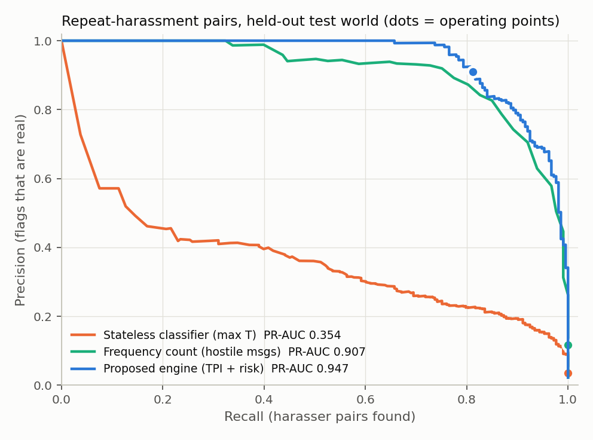
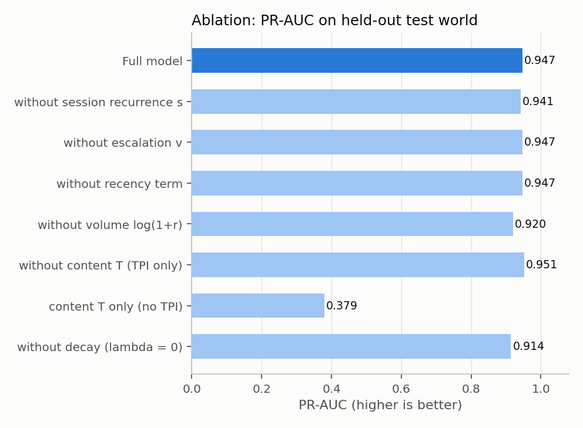
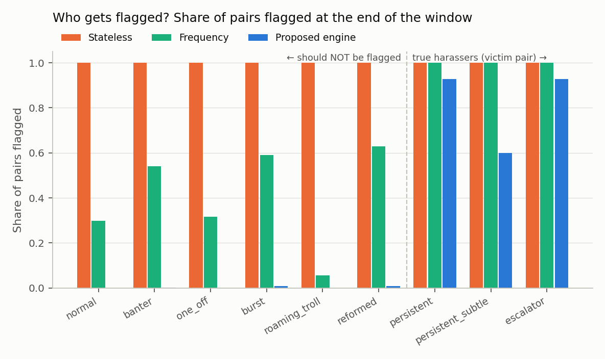
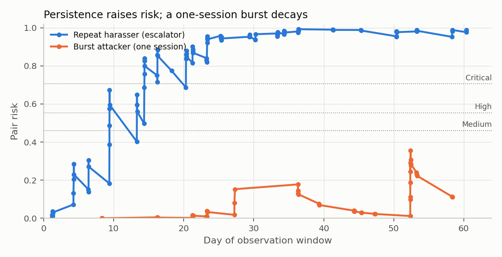
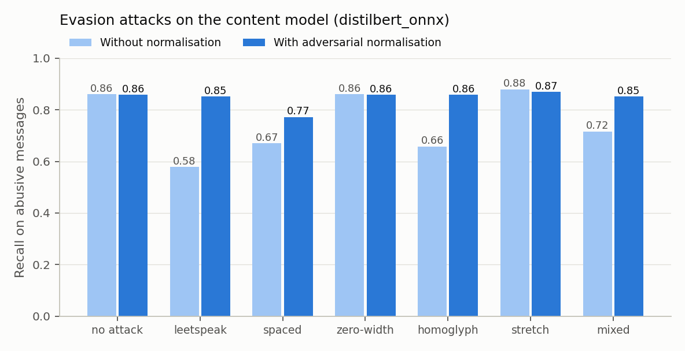

# Evaluation Report: Behavioral Analytics Engine

Component of J26-CS-337, by Jayarathna W.D.O.B. (IT23212640). Generated automatically by `scripts/evaluate.py`.

**Content model used in these experiments:** `distilbert_onnx`. Re-run `python scripts/evaluate.py` to regenerate every number.

## 0. Content model (Stage B1): threat signal T

| Model | Jigsaw mean ROC-AUC | Jigsaw macro-F1 (6 labels) | Abusive vs clean F1 (Jigsaw test) | Threat F1 | Davidson tweets F1 (cross-domain) | Moderation set F1 |
|---|---|---|---|---|---|---|
| distilbert_onnx | 0.984 | 0.612 | 0.711 | 0.510 | 0.898 | 0.561 |
| tfidf_lr | 0.980 | 0.565 | 0.694 | 0.513 | 0.842 | 0.481 |

Per-label tuned thresholds come from the validation split. The Jigsaw test labels are known to be noisy. Davidson is short tweet text, closer to live chat.

## 1. Fitted risk model (proposal Appendix B)

- Selected decay half-life: **30.0 days** (grid search on the validation world)
- Risk = σ(-11.75 + **1.10**·T + **2.79**·log(1+r) + **0.20**·s + **3.98**·recency + **0.00**·v)
- β (total TPI weight) = 6.97; normalised TPI weights: w₁ = 0.40, w₂ = 0.03, w₃ = 0.57
- Standardised feature importance (coefficient × feature std): {'T_pair': 0.1381, 'log_r': 1.8095, 's': 0.3841, 'recency': 1.4553, 'v': 0.0}
- Tier boundaries: Medium ≥ 0.461, High ≥ 0.554, Critical ≥ 0.706

## 2. E1: Pair-level detection on the held-out test world

9,481 (offender, target) pairs, of which 213 are true repeat-harassment pairs. Message texts come from a pool the content model never saw.

| System | ROC-AUC | PR-AUC | Precision | Recall | F1 | Pairs flagged |
|---|---|---|---|---|---|---|
| (a) Stateless classifier (any T ≥ 0.5) | 0.963 | 0.354 | 0.036 | 1.000 | 0.070 | 5,898 |
| (b) Frequency rule (≥ 3 hostile) | 0.997 | 0.907 | 0.117 | 1.000 | 0.210 | 1,815 |
| **(c) Proposed engine (tier ≥ High)** | 0.998 | 0.947 | 0.910 | 0.812 | 0.859 | 190 |
| (d) Upper bound: gradient boosting | 0.998 | 0.939 | 0.900 | 0.850 | 0.874 | 201 |

Tier distribution by ground-truth label (0 = not a repeat harasser, 1 = repeat harasser):

| Label | Low | Medium | High | Critical |
|---|---|---|---|---|
| 0 | 9238 | 13 | 14 | 3 |
| 1 | 34 | 6 | 12 | 161 |

## 3. E2: Ablation study (PR-AUC, test world)

| Variant | PR-AUC |
|---|---|
| Full model | 0.947 |
| without session recurrence s | 0.941 |
| without escalation v | 0.947 |
| without recency term | 0.947 |
| without volume log(1+r) | 0.920 |
| without content T (TPI only) | 0.951 |
| content T only (no TPI) | 0.379 |
| without decay (lambda = 0) | 0.914 |

## 4. E3: Who gets flagged

Share of pairs with at least one hostile message that each system flags. For harasser personas only the true victim pair is counted.

| Persona | Pairs | Stateless | Frequency | Engine |
|---|---|---|---|---|
| normal | 2364 | 1.00 | 0.30 | 0.00 |
| banter | 461 | 1.00 | 0.54 | 0.00 |
| one_off | 316 | 1.00 | 0.32 | 0.00 |
| burst | 244 | 1.00 | 0.59 | 0.01 |
| roaming_troll | 1740 | 1.00 | 0.06 | 0.00 |
| reformed | 124 | 1.00 | 0.63 | 0.01 |
| persistent | 110 | 1.00 | 1.00 | 0.93 |
| persistent_subtle | 75 | 1.00 | 1.00 | 0.60 |
| escalator | 28 | 1.00 | 1.00 | 0.93 |

Recall on true harasser pairs, by harasser type:

| Harasser type | Stateless | Frequency | Engine |
|---|---|---|---|
| escalator | 1.00 | 1.00 | 0.93 |
| persistent | 1.00 | 1.00 | 0.93 |
| persistent_subtle | 1.00 | 1.00 | 0.60 |

## 5. E4: Real-time behaviour (streaming replay)

213 harasser pairs and 9,268 other pairs, replayed message by message.

| System | Harasser pairs detected | Median sessions to detect | False-alarm pairs | False-alarm rate |
|---|---|---|---|---|
| stateless | 100.0% | 1.0 | 5,685 | 61.34% |
| frequency | 100.0% | 2.0 | 1,602 | 17.29% |
| engine_medium_or_above | 97.2% | 4.0 | 710 | 7.66% |
| engine | 95.8% | 4.0 | 696 | 7.51% |
| engine_no_override | 91.5% | 6.0 | 89 | 0.96% |

`engine_no_override` is the same engine with the explicit-threat override disabled. False-alarm pairs caused **only** by the override (P(threat) ≥ 0.9) in the normal engine: **607** (6.55% of non-harasser pairs); 452 of them contain a message with a Jigsaw *threat* label, 155 were triggered by text without that label.

## 6. E5: Stress tests

**test_noisy**

| System | ROC-AUC | PR-AUC | Precision | Recall | F1 |
|---|---|---|---|---|---|
| stateless | 0.949 | 0.253 | 0.038 | 1.000 | 0.074 |
| frequency | 0.983 | 0.626 | 0.103 | 0.995 | 0.187 |
| engine | 0.987 | 0.702 | 0.564 | 0.665 | 0.610 |

**test_rotation**

| System | ROC-AUC | PR-AUC | Precision | Recall | F1 |
|---|---|---|---|---|---|
| stateless | 0.733 | 0.372 | 0.281 | 0.845 | 0.422 |
| frequency | 0.714 | 0.307 | 0.382 | 0.298 | 0.335 |
| engine | 0.715 | 0.317 | 0.000 | 0.000 | 0.000 |

Victim-centric coordinated-pressure alert: **100.0%** of harassment victims alerted, versus 12.0% of other targets.

## 7. E6: Adversarial evasion of the content model (distilbert_onnx, 1,500 abusive messages)

| Attack | Recall with normalisation | Recall without |
|---|---|---|
| none | 0.858 | 0.861 |
| leet | 0.851 | 0.578 |
| spaced | 0.773 | 0.671 |
| zero_width | 0.858 | 0.861 |
| homoglyph | 0.858 | 0.658 |
| stretch | 0.870 | 0.879 |
| mixed | 0.852 | 0.717 |

## 8. E7: Latency (CPU, per message, end to end incl. content model)

| Store | p50 ms | p95 ms | max ms |
|---|---|---|---|
| plain_sqlite | 8.06 | 9.89 | 11.07 |
| sqlcipher_encrypted | not run (sqlcipher3 not installed) | | |

Engine overhead alone: 0.18 ms/message. Target: ≤ 250 ms.

## 9. E8: Real-data sanity check

Toxic Comment Moderation (1,050 comments, 308 users). Users by tier: {'Low': 305, 'Medium': 0, 'High': 3, 'Critical': 0}. Mean toxic comments per user by tier: {'Low': 1.21, 'Medium': nan, 'High': 5.67, 'Critical': nan}. Spearman ρ (toxic count vs tier) = 0.1593.

_No victim/target field in this dataset, so all comments resolve to the page owner; this only checks that tiers order real users sensibly, not the TPI itself._

## 10. Threats to validity

- **Synthetic behaviour.** The TPI is validated on a simulated multi-session corpus because no public corpus records cross-session offender–target interactions. Message texts are real, but behaviour patterns are designed. Hard negatives (banter, bursts, roaming trolls, reformed users) and hard positives (subtle harassers) were added, along with target-resolution noise, to reduce circularity. Results should be confirmed on real platform logs.
- **Generator vs model independence.** The generator does not use the TPI formula. The fitted coefficients, not hand-set weights, decide what matters.
- **Account rotation** defeats any per-account history. The victim-centric pressure alert is a partial mitigation; linking accounts (device or behavioural fingerprinting) is future work.
- **Domain shift.** Jigsaw is Wikipedia talk-page text; live chat is shorter and more informal (see the Davidson cross-domain result).
